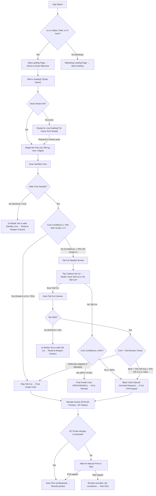

# TunaEye v2.6.4 — App Logic, Decision Rules & Flow (`IF → THEN` Guide)

This document explains **every decision, threshold, and screen transition** in TunaEye in plain `IF → THEN` logic, matching the exact implementation in [kioskState.ts](file:///c:/Users/g11ar/OneDrive/Pictures/TUNAEYE/tunaeye/src/kioskState.ts) and [exact-ui.ts](file:///c:/Users/g11ar/OneDrive/Pictures/TUNAEYE/tunaeye/src/exact-ui.ts).

---

## 1. End-to-End Grading Flow

---

## 2. Core Grading & Tail-Cut Rules (`IF → THEN`)

### Rule A — Invalid / Non-Tuna Image
- **IF** the model returns `INVALID` (or HTTP `422`) on either Sashibo Core or Tail-Cut:
  - **THEN** discard any temporary saved image, clear the frozen camera preview, show the **`Not a valid Sashibo core / Tail cut`** modal for **2 seconds**, and **automatically reopen the live camera** so the grader can scan again immediately.

### Rule B — High-Confidence Sashibo Core ($\ge 75\%$, Grade A or B)
- **IF** Sashibo Core is **Grade A** or **Grade B** **AND** confidence is **$\ge 75\%$**:
  - **THEN** **Tail-Cut is NOT requested**.
  - **THEN** go straight to the **Final Grade** screen (`Green` card for A, `Yellow` card for B) and allow immediate printing.

### Rule C — When Tail-Cut IS Requested ($< 75\%$ Confidence **OR** `Grade C`)
- **IF** Sashibo Core confidence is **$< 75\%$** **OR** Sashibo Core predicts **`Grade C`** (even if confidence is $\ge 75\%$):
  - **THEN** go to the **`Tail cut needed`** screen first (showing the captured Core photo, Core score circular gauge, and `Next: Tail cut` card).
  - **THEN** when the grader taps **`Capture tail cut`**, open the **`Is a Tail-Cut sample available?`** modal with two side-by-side choices:
    - **`Scan Tail-Cut`** → opens the Tail-Cut camera.
    - **`No Tail-Cut`** → marks the session as **`PROVISIONAL`** and goes to the Final Grade screen.

---

## 3. Provisional (`No Tail-Cut`) Rules (`IF → THEN`)

When the grader taps **`No Tail-Cut`**:
- **IF** Sashibo Core confidence is **$\ge 60\%$** (`60.0%` or higher):
  - **THEN** show the Final Grade Card (`Green` / `Yellow` / `Red`) tagged **`PROVISIONAL`**, and allow the grader to **Print receipt** directly (or optionally tap **`Override`**).
- **IF** Sashibo Core confidence is **$< 60\%$** (`59.9%` or lower):
  - **THEN** show the **Black Gradient Card** (`Manual override required` / `PROVISIONAL`) and require an authorized grader's **2-Column PIN Override** (`PIN: 1234`) before printing.

---

## 4. Combined Core + Tail-Cut Rules (`IF → THEN`)

When **both** Sashibo Core and Tail-Cut have been scanned:

1. **Severe Disagreement (`A` vs `C`):**
   - **IF** Core is **`Grade A`** and Tail-Cut is **`Grade C`** (or Core is **`Grade C`** and Tail-Cut is **`Grade A`**):
   - **THEN** **Black Gradient Card** (`Manual override required`) — *"Severe model disagreement"* — requires PIN override.
2. **Low Combined Confidence:**
   - **IF** **both** Core and Tail-Cut are $< 75\%$ **OR** their average confidence `((Core + Tail) / 2)` is **$< 75\%$**:
   - **THEN** **Black Gradient Card** (`Manual override required`) — requires PIN override.
3. **Agreement:**
   - **IF** Core and Tail-Cut predict the **same grade** (e.g., `B` + `B`) and average confidence is $\ge 75\%$:
   - **THEN** accept that grade and go to **Print receipt**.
4. **Mild Disagreement (`A` + `B` or `B` + `C`):**
   - **IF** they differ by one tier (e.g., `A` + `B`, or `B` + `C`) and average confidence is $\ge 75\%$:
   - **THEN** `combineGrades()` blends the class probability scores (or confidence-weighted points: `A=3, B=2, C=1`) to pick the final grade and allows **Print receipt**.

---

## 5. Grade Card Color & Flagged Override Rules (`IF → THEN`)

- **IF** Grade = **`A`** → Hero Grade Card, Receipt Summary Card, and Completion Card = **Green Gradient** (`#0d9458` → `#12a56a`).
- **IF** Grade = **`B`** → **Yellow/Amber Gradient** (`#d97706` → `#eab308`).
- **IF** Grade = **`C`** → **Red Gradient** (`#dc2626` → `#ef4444`).
- **IF** `decision.reviewFlagged === true` (low combined confidence, A vs C disagreement, or provisional `< 60%`):
  - **THEN** keep the normal Grade A/B/C card (no blocking black card), display the amber **`FLAGGED FOR MANUAL OVERRIDE`** header chip + in-card warning pill, highlight **`Override`**, and allow operators to call an Admin-registered **Expert Grader** to authorize using their **personal 4-digit PIN + optional 100% offline TOTP 2FA** (or single-use recovery code).

---

## 6. Navigation, Weight & Exit Guard Rules (`IF → THEN`)

- **Weight Keypad (`weight`):**
  - **IF** no decimal point: max **3 digits** (valid range **`15–200 kg`**).
  - **IF** decimal point `.` is present: max **4 digits total** excluding the dot (e.g., `78.12` or `125.6`).
- **Back on Final Grade (`final`):**
  - **IF** grader taps **`← Back`**:
  - **THEN** show **`Do you want to leave the session?`** → **`Yes, leave session`** discards the fish and returns to **`Weigh the fish`**.
- **Back on Weight Input (`weight`):**
  - **IF** grader taps **`← Back`**:
  - **THEN** show **`Exit as [Grader Name] ?`** → **`Yes, exit`** clears `S.name` + `localStorage['te-name']` and returns to **`Who's grading?`** (`Who’s grading?`).

---

## 7. Printing, Food Safety & Offline Durability Rules (`IF → THEN`)

- **Scanning Screen (`core` / `tail`):** Always displays a non-blocking **Food Safety** notice in the bottom footer bar (`.lt-foot`) outside the viewfinder.
- **Receipt Screen (`receipt`):**
  - **IF** a 58mm Bluetooth printer was already paired → auto-print via **Web Bluetooth ESC/POS** after `700ms`.
  - **IF** no Bluetooth printer is connected → wait for manual **Print**, **Pair BT Printer**, or **Skip**.
  - Every receipt includes the 1-line footer `Visual quality assist only · Not a food-safety test.` plus `EXPERT OVERRIDE: <Name>` when overridden.
- **Completion Screen (`done`):** Shows **`Results printed.`** or **`Results recorded.`** with a 3-second countdown to the next fish.
- **Durability & Sync:** Station state (expert graders, PIN/TOTP config, prices, audit logs, settings) mirrors to SQLite WAL (`server/station.py` `/local-api/state`) and drains all pending records + audit logs to Supabase when online. Secret Admin `"A"` mode has been removed.
