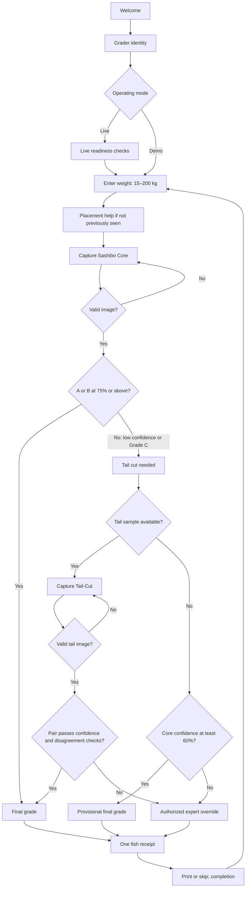
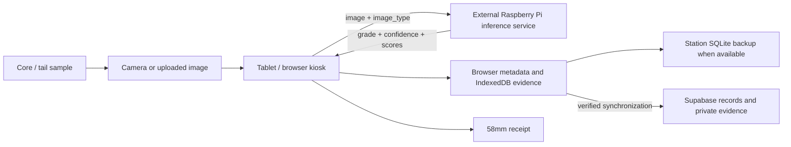

# TunaEye: Project Scan and Animated Demo Reference

Source snapshot: **20 November 2026**. Project: `TunaEye/tunaeye` in this checkout.

This is a source-based production brief for a new animated product demo. It covers the current application, grading rules, local station service, cloud contract, visual assets, existing video projects and suggested scenes. **The storyboard is a recommendation; implementation descriptions come from the current source.** No application behavior was changed during this scan.

## 1. The product in one paragraph

TunaEye is an AI-assisted yellowfin tuna grading station. An operator identifies the grader, enters the fish weight, and captures a Sashibo Core image. The application requests an external Raspberry Pi model prediction, then either presents a final grade, requests a supplementary Tail-Cut sample, or requires an authorized expert decision. It produces a thermal receipt and retains grading records and photographic evidence locally, with synchronization to Supabase when available. The expert remains responsible for the decision.

Suggested central message:

> From sample to supported decision: guided capture, AI-assisted grading, expert review, and a traceable record.

The strongest demo story is the complete working relationship between the grader and station. Show the sample, the evidence, the decision and the resulting record.

## 2. What is actually running

The active entry is [src/main.tsx](../src/main.tsx). It calls `launchExactUI(false)` from [src/exact-ui.ts](../src/exact-ui.ts), which imports [new ui/index (4).html](../new%20ui/index%20%284%29.html) as raw markup and connects its presentation to real application services.

The supplied HTML contains both the public website and an embedded kiosk. The adapter replaces prototype capture, grading, PIN, storage, printing and sync behavior. The public website normally lives in an iframe; its opened kiosk is nested inside it. Direct kiosk entry uses the embedded kiosk immediately.

**The large React `App.tsx` and `MarketingLanding.tsx` remain in the repository but are not the mounted main application.** Their screens, selectors and older recordings are secondary references. React is still used by the loading dial and the separate video projects.

Entry behavior in `exact-ui.ts`, around lines 1639–1647:

| Context | Entry |
| --- | --- |
| Ordinary desktop visitor | Public website |
| Touch/tablet/mobile, installed standalone/fullscreen app, or recognized Pi host | Direct kiosk |
| `?kiosk=1` | Force direct kiosk |
| `?landing=1` or `?web=1` | Force public website |

Use these query parameters for new capture work. Do not assume old `/camera` or `/admin` React routes describe the current iframe-based interface.

## 3. Repository map

| Location | What it contains | Relevance to the animation |
| --- | --- | --- |
| [src/](../src/) | Active adapter, grading state, services, older React UI and shared components | Behavioral source of truth |
| [new ui/](../new%20ui/) | Supplied full HTML presentation and original photography | Current screen and layout reference |
| [public/](../public/) | Logos, specimen images, fonts, installation assets, photos, PWA files | Reusable production assets |
| [server/station.py](../server/station.py) | Python SQLite persistence, static hosting and Pi proxy | Local durability and station architecture |
| [supabase/migrations/](../supabase/migrations/) | Record/evidence access rules, prices, provenance and grader identity schema | Cloud data contract |
| [docs/](./) | Integration contracts, release notes, readiness and proposals | Supporting references; check against code |
| [tests/](../tests/) and [scripts/](../scripts/) | Browser suites, focused verification, cache/font utilities | Future capture and regression checks |
| [android/](../android/) | Partial Capacitor scaffold and generated bundled assets | Packaging reference; not a verified native release |
| [tunaeye-product-demo/](../tunaeye-product-demo/) | Earlier 90-second Remotion walkthrough | Reusable editing/capture approach |
| [tunaeye-cinematic-film/](../tunaeye-cinematic-film/) | Earlier 120-second cinematic and combined edits | Reusable motion design and scene structure |
| [tasks/](../tasks/) | Work plans and lessons | Prior constraints and historical verification notes |
| Root Markdown files | README, architecture, features, audits and decision guides | Mixed-age product context |
| `dist/`, Android bundled web assets, ZIP/TAR archives, test results | Generated outputs and reports | Historical deliverables; not source authority |
| `data/` | Local station runtime data | Operational data, not presentation assets |

Main stack: Vite, TypeScript, React dependencies, browser APIs, Python standard-library SQLite service and Supabase. Capacitor configuration is present. Both animation projects use their own React/Remotion dependencies.

The scan covered first-party source, configuration, documentation, test definitions and asset/media inventories. Dependency internals, private environment values, runtime database contents, generated bundle internals and archive contents were excluded. Existing videos were inventoried and their source/QA reports read; the videos were not replayed or newly rendered.

## 4. Product surfaces worth showing

### Public website

The HTML presentation includes Home, Features, About, Team, FAQ, Terms and Privacy. It contains the “Sea Beyond the Cut” brand hook, an expert-support message, Sashibo/Tail-Cut criteria, station/device illustrations, workflow explanation, an editable grade/weight price calculator, phone previews, installation help, project photography and version history.

Its visual explanation of expert criteria can inspire animation: core translucency/color/structure and tail grain/color/moisture. **These are presentation descriptions, not evidence that the deployed model individually measures each property.** Do not animate numerical oil content, shelf life or spoilage measurements as actual outputs.

Some website copy is ahead of or inconsistent with the implementation. In particular, it mentions Convex live broadcasting, 80mm printing, sub-200ms or “zero-latency” inference and specific hardware specifications. Those claims are not established by this checkout. Use the current-source descriptions below in narration and overlays.

### Operator kiosk

Useful shots: welcome, grader identity, live readiness checklist, weight keypad, placement help, camera alignment, frozen captured image, analysis state, tail-needed screen, final result, expert override, receipt, completion and grading history.

### Administration

Current [exact-admin.ts](../src/exact-admin.ts) and [exact-technical.ts](../src/exact-technical.ts) provide:

- Overview with saved-record metrics, session/sample counts, weight, value, pending records, weekly volume, grade distribution and recent records.
- Records with search, eight-row pagination, CSV export, evidence review, original prediction/override details, identifiers and sync state.
- Grade A/B/C price editing with peso-per-kilogram rates.
- Grader name management, with history preserved when names are removed from the list.
- Device and API diagnostics for Pi, camera, cloud, local storage and queues.
- Station/API/camera/model settings, local PIN controls, demo/live switching and retention controls.
- Local audit log and cloud administrator sign-in controls.

Show data-dependent cards with clearly labeled sample data. The existence of diagnostic controls does not establish that a physical device passed them.

## 5. Current grading journey



The active flow starts with the core. It does not ask the operator to select both sample types or associate “same fish/different fish” as the old recordings do. Weight is entered manually. Placement help can appear before capture depending on stored tutorial history, so an empty capture profile and a returning profile may differ.

Live readiness displays six checks: Pi network, inference server, camera snapshot, Sashibo model, Tail-Cut model and local evidence/SQLite storage. Five are required; a camera warning can allow alternative capture sources. See [liveReadiness.ts](../src/liveReadiness.ts), particularly lines 139–210.

### Decision rules to preserve in the demo

Authority: [kioskState.ts](../src/kioskState.ts), `ACCEPT_CONFIDENCE`, `combineGrades()` and `decisionFor()` around lines 72–175.

| Situation | Current decision |
| --- | --- |
| Core is `INVALID`, or capture receives a rejected-sample HTTP 422 | Show rejection and request a retake |
| Core A or B, confidence **≥75%** | Final grade; tail not required |
| Core below 75%, or **core Grade C at any confidence** | Request supplementary tail availability |
| No tail available, core confidence **≥60%** | Allow a **provisional** core-only final result |
| No tail available, core confidence **<60%** | Require expert confirmation |
| Tail invalid | Retake tail; do not treat it as a usable supplementary prediction |
| Core/tail disagreement is A versus C | Require expert confirmation |
| Both results fail acceptance, or mean confidence is below 75% | Require expert confirmation |
| Pair passes checks and grades agree | Accept the agreed grade |
| Pair passes checks and grades differ by one tier | Combine predictions to choose the grade |
| Authorized expert selects final grade with a reason | Preserve original model details and use the expert decision |

Combination averages the `GRADE_A`, `GRADE_B` and `GRADE_C` score vectors and picks the largest mean. If complete vectors are unavailable, it uses confidence-weighted grade points A=3, B=2, C=1. **Do not infer grade A/B/C from the confidence percentage alone.**

The confidence used to gate a pair is not one universal final confidence output. `decisionFor()` returns core confidence for agreement and tail confidence for blended disagreement; some interface displays summarize a mean. Show sample percentages next to their own images, and avoid calling a displayed percentage “system accuracy.”

An optional [experimental policy](../src/gradingPolicy.ts) checks backend acceptance, confidence ≥85% and a ≥20-percentage-point score margin. It is conditional on a build flag. This scan did not inspect private deployment environment values; the ordinary 75% source path above should be checked against the actual capture build before filming.

### Rejection and expert control

The active adapter displays an invalid-sample modal for about two seconds, clears the rejected preview and reopens capture. New live evidence is staged temporarily and promoted only after acceptance, preserving previously accepted evidence when a replacement is rejected.

Expert override uses a two-column dialog: grade A/B/C and required reason on one side, four-digit station PIN keypad on the other. The saved result includes the original grade/confidence plus override grade, reason, actor and timestamp. An accepted override proceeds to the receipt.

For animation, this is a useful human-control scene: show ambiguous evidence, pause, then let the expert confirm with a reason. Mask the PIN.

## 6. Capture, inference and hardware architecture



[piClient.ts](../src/piClient.ts) defines the inference contract:

| Endpoint | Purpose |
| --- | --- |
| `GET /status` | Service/version/model metadata and model readiness |
| `GET /stream` | Live camera preview |
| `GET /snapshot` | Captured image bytes |
| `POST /grade` | Multipart `image` plus `image_type=sashibocore` or `tailcut` |

The grade response includes inference/capture IDs, a predicted class A/B/C/INVALID, confidence and per-class scores. The client validates the response and handles rejected samples and API failures. Live inference is external: **`server/station.py` is a persistence/static-host/proxy service, not the CNN implementation.** No trained model binaries or training implementation were established in the inspected application source.

Current camera choices include Pi camera, DroidCam stream/snapshot, browser cameras through `getUserMedia`, and image upload. A browser camera alternative changes capture, not the requirement for a live inference service. Demo mode supplies simulated inference separately.

Pi-local builds use same-origin API paths. HTTPS hosting requires a configured authenticated HTTPS gateway; the client does not allow an HTTPS page to silently use HTTP Pi endpoints. Hosting the website online alone does not connect a visitor to a physical station.

Weight remains manual in the active workflow. Do not show a connected scale automatically populating the field as implemented behavior. Lighting chamber quality, camera calibration, model readiness and physical printer output require hardware validation.

## 7. Records, pricing and synchronization

### What a record preserves

[gradingRecords.ts](../src/gradingRecords.ts) stores session ID, stable record ID, timestamp, grader, sample type, fish association, weight, final grade/status, evidence references, original inference details, override details and financial/sync metadata.

One fish session can produce core and tail sample rows linked by `sessionId`. History groups them as a fish session. The intended receipt is one final transaction for the fish; do not animate two separate purchases just because two sample rows exist.

| Layer | Implementation |
| --- | --- |
| Browser metadata/outbox | `localStorage`, key `tunaeye-records` |
| Captured evidence | IndexedDB, with Blob data and stable image IDs |
| Station backup | `/local-api/records` and `/local-api/evidence/...` backed by SQLite |
| Cloud rows | Supabase `grading_records` |
| Cloud evidence | Private Supabase Storage bucket `grading-images` |
| Other cloud data | Grade prices, station graders and authorization/profile schema |

Live captures persist before receipt printing. Browser-only storage and confirmed SQLite storage have different messages. The SQLite service saves row and image transactionally and supports replay with stable IDs. Do not imply every browser-only or static-hosted session has confirmed SQLite durability.

Default prices in [pricing.ts](../src/pricing.ts) are **A ₱420/kg, B ₱350/kg, C ₱280/kg**. They are configurable station rates, not current market quotations. A record stores its price snapshot; reprinting uses historical rates rather than today's edited schedule. A possible illustrative calculation is 85 kg × ₱420 = ₱35,700, provided the capture station still uses that rate.

### Current sync behavior: local first, with background attempts

The shared sync process uploads evidence, upserts by stable ID, reads back the row, downloads the image to compare its bytes, and only then marks it synced. Network failures retain pending work; other failures remain visible for retry. Browser retention prunes only older verified-synced records beyond the newest 200.

**Current code is not manual-only**, despite older documents and some visible Settings copy:

- `Sync now` is available for explicit operator action.
- `exact-ui.ts`, around lines 1717–1744, also attempts background synchronization on online/foreground events and a 30-second timer, throttled to at least 60 seconds, in batches of up to ten.
- `exact-admin.ts`, around lines 29–47, can initiate synchronization when enhancing Admin and retrieve cloud records/graders.
- Grader names may synchronize automatically as well.

Narration should say “Records stay local when cloud connectivity is unavailable, then synchronize when connectivity and access permit.” If the film shows a deliberate Sync now action, show that action without claiming it is the only trigger.

Pi hotspot access is not proof of internet access. Offline operation means the cached interface and local records can remain available; live inference still needs a reachable local Pi. The service worker excludes inference, camera, local APIs, cloud/auth and no-store probes from ordinary cache responses.

Local station PIN control and Supabase cloud authorization are separate. The source includes hashed PIN support and a failed-attempt cooldown; do not present local name entry as a personal cloud account login. Actual cloud access depends on deployed authentication and RLS configuration.

## 8. Receipt and completion

Authority: [thermalReceipt.ts](../src/thermalReceipt.ts) and the receipt/reprint handlers in `exact-ui.ts`.

- **58mm** thermal output, with station, order, grader, time, weight, final grade, core/tail details, rate and total.
- Demo/provisional labels where applicable; HTML output includes a Code128 barcode.
- Direct Web Bluetooth ESC/POS transport when an appropriate printer is connected; otherwise an isolated system print document.
- Automatic print starts after approximately **700ms only when Bluetooth is already connected**. Otherwise show Print, Pair or Skip.
- Print errors retain retry controls and saved records. Reprint requires a confirmed saved decision and valid original financial snapshot.
- Completion distinguishes “Results printed.” from “Results recorded.” and runs a three-second next-fish countdown.

A transport or system-print invocation does not establish physical paper delivery. For a rendered product film, a receipt animation can represent the intended output; do not call it a hardware test.

## 9. Demo mode and reproducible scene choices

The active interface has explicit demo/live controls on grader entry and in Admin Settings. It persists the choice and prevents switching during an unfinished graded session. The adapter calls `setKioskDemoMode()` directly, so older claims that a build flag alone blocks every simulation path do not describe this entire active flow.

Use the visible mode switch when preparing captures. Current demo capture/override paths skip operational record persistence. Demo receipts are labeled. **Demo mode does not mean existing live records cannot be synchronized by the background sync code**; use a clean presentation browser profile without operational records or cloud sessions.

Preset source: [demoMode.ts](../src/demoMode.ts).

| Scenario | Core | Tail | Scene to capture |
| --- | --- | --- | --- |
| `confident` / Sashibo accepts | A, 96.3% | Not needed | Fast core-only success |
| `grade-b` | B, 94% | Not needed | Amber Grade B result |
| `grade-c` | C, 94% | C, 94% | High-confidence C still requests tail, then confirms C |
| `needs-tail` | C, 74.2% | B, 91.4% | Supplementary evidence and blended result |
| `needs-expert` | B, 68.1% | C, 66.4% | Required expert confirmation |
| `invalid-core` | INVALID | Not needed | Reject and retake core |
| `invalid-tail` | C, 74.2% | INVALID | Reject supplementary sample |

For a provisional scene, use the low-confidence core and choose No Tail-Cut. Its 74.2% is above the 60% provisional floor. A below-60% provisional-override scene needs a controlled API fixture or separately prepared capture; it is not a dedicated preset in this table.

### Important capture integrity issue

The active adapter contains a persisted hidden Grade-A promotion control (`tunaeye-secret-a`, `exact-ui.ts` around lines 25–28, 303–321 and 1418–1441). When armed, the third and later valid scans can be rewritten to Grade A with altered confidence/scores, including in live mode.

**Keep this disabled for all representative footage. Do not present rewritten results as raw model predictions or evidence of accuracy.** Use the openly labeled demo scenarios for scripted outcomes. This guide records the existing behavior; no grading or security code was changed.

## 10. Visual identity and reusable assets

### Current presentation

| Element | Current source direction |
| --- | --- |
| Public typography | Inter with Instrument Serif accents |
| Kiosk/admin typography | Inter, large numeric fields, compact operational labels |
| Landing colors | Blue `#1b6cf0`, deep blue `#0a45d8`, pale background `#f4f6fa`, dark ink `#0b1a3a` |
| Kiosk colors | Blue `#2563ff` / `#3b8bff`, pale panels, white surfaces |
| Grade A | Green gradient, including `#0d9458` and `#12a56a` |
| Grade B | Amber/yellow gradient, including `#d97706` and `#eab308` |
| Grade C | Red gradient, including `#dc2626` and `#ef4444` |
| Required override | Charcoal/black gradient |
| Motion motifs | Camera framing rails, scan line, evidence reveal, percentage ring, grade card, paper feed, next-fish countdown |

The active adapter suppresses many decorative transitions on coarse-pointer/smaller viewports for performance. A desktop capture is not guaranteed to show exactly the same motion as the tablet. Preserve the real tablet layout and add editorial emphasis outside the screen when needed.

The loading dial in [exact-loading.tsx](../src/exact-loading.tsx) mounts [KiloThermalDial.tsx](../src/KiloThermalDial.tsx). `main.tsx` disables the optional launch boot dial, while landing-to-kiosk transitions can still request it. Do not treat the dial as a scale measurement or actual model-progress telemetry.

### Asset shelf

All paths below are relative to the repository root.

| Assets | Use |
| --- | --- |
| `public/tunaeye-logo.svg`, `tunaeye-192.png`, `tunaeye-512.png` | Brand and app identity |
| `public/DEMO_SAMPLES/SASHIBOCORE_A.png`, `_B.png`, `_C.png` | Core specimens for labeled demo outcomes |
| `public/DEMO_SAMPLES/TAILCUT_A.png`, `_B.png`, `_C.png` | Tail specimens for labeled demo outcomes |
| `public/assets/sashiboCoreFull.png`, `tailCutFull.png` | Sample cutouts/illustrations |
| `public/assets/step 1.png`–`step 3.png` | Placement/help imagery |
| `public/assets/tunaeyebackground.png`, `tunaEyeLoadingScreen.png` | Existing backdrop/brand imagery |
| `public/new-ui/sashibo.webp`, `tail.webp`, `tablet.webp` | Current presentation artwork |
| `public/new-ui/phone-1.webp`–`phone-5.webp` | Phone preview imagery; not proof of a connected phone implementation here |
| `public/new-ui/kiosk/welcome-background.jpg` | Current kiosk welcome background |
| `public/new-ui/install-qr.png`, `public/assets/mobile app qr.png` | Existing installation QR artwork; confirm destination before featuring it |
| `public/app-screens/` | Five existing phone screenshot JPGs |
| `public/docu/consultations/` | Seven project consultation photos |
| `public/docu/data-collection/` | Six data collection photos |
| `public/docu/tuncam/` | Five TunCam documentation photos |
| `public/fonts/` | Inter weights 300–900, Instrument Serif regular/italic, Open Runde WOFF2; local licenses for Inter/Instrument Serif |

`public/assets/team/` has a portrait README but no portrait files in this scan. Use the existing template artwork or obtain the intended portraits before planning a portrait montage. Photography can establish project context; it does not establish measured model performance.

## 11. Existing animation projects

There is already substantial reusable video work. It predates the current exact interface.

| Project | Compositions | Format |
| --- | --- | --- |
| [Product demo](../tunaeye-product-demo/README.md) | `TunaEyeKioskDemo`, `TunaEyeNoNarration`, individual scenes | 90 seconds, 1920×1080, 60fps; 720p/30 preview |
| [Cinematic film](../tunaeye-cinematic-film/README.md) | `TunaEyeCinematic`, `TunaEyeNoNarration`, individual acts | 120 seconds, 1920×1080, 60fps |
| [Combined cut](../tunaeye-cinematic-film/combined-README.md) | `TunaEyeCombined`, `TunaEyeCombinedNoNarration`, `TunaEyeCombinedVisual`, `CombinedFeatures` | 120 seconds; product workflow plus conceptual/brand scenes |

Their Roots, compositions, storyboards, capture scripts, audio scripts and QA reports are present. `tunaeye-cinematic-film/src/design.tsx` contains reusable typography, light sweep, specimen reveal, focus, tablet, screenshot and UI-interaction primitives. `Vision.tsx` and `CombinedVision.tsx` contain conceptual network animation. Label such networks conceptual; actual model architecture and feature maps were not verified. Existing MobileNetV3 labels need backend confirmation before reuse.

These projects use Open Runde and an older royal-blue film palette (`#3D40FE`). That can remain an editorial frame, but current product footage should keep its actual Inter/blue styling.

### Reuse limits

- Old recordings show sample selection, same-fish association, earlier placement/weight ordering, separate sample results/receipts and older Admin UI. Recapture current screens.
- Capture scripts use old selectors and deterministic camera/model fixtures. Update them before recording this interface, including its iframe structure.
- Original product/cinematic narrated and instrumental exports exist, with historical passed QA reports. Those reports were not rerun in this scan.
- Combined instrumental MP4/preview and audio stems exist. The combined README still records revised narration as pending; final combined instrumental export/playback verification is also pending in its visual review. Do not assume every named composition has a finished, verified export.
- Earlier cloud demonstration footage intercepts responses and is labeled `DEMO CLOUD · SIMULATED SYNC`. Keep that distinction if reusing it.

### Existing commands

From the main repository:

```powershell
rtk npm run dev
rtk npm run dev:demo
rtk npm run build:demo
rtk npm run preview
rtk npm run build:pi
```

The app uses port 3000. Select Demo mode explicitly in the current kiosk before recording scripted grading. Building writes `dist/`; do not overwrite a prepared live release merely to inspect the project.

From either animation project, the existing package scripts include Studio (`npm run dev`), lint, capture, prepare, audio mixing, rendering and verification. Read that project's README first: scripts have local browser/FFmpeg assumptions, and capture scripts need workflow updates. The combined cut additionally has direct `scripts/combined-*.mjs` utilities. No new video tooling or dependencies are required merely to start planning this demo.

## 12. Suggested new 120-second animated demo

This is an editorial proposal, not an existing verified video. Use one clear main path, then short branch examples. If a shorter film is required, remove the provisional/error branches before compressing the readable main workflow.

| Time | Scene | Visual/action | Suggested narration |
| --- | --- | --- | --- |
| 0–8s | Hook | Macro core/tail reveal; eye/brand motif | “Every cut carries evidence. Every grade needs judgment.” |
| 8–16s | Human role | Grader silhouette/project context transitioning into station | “TunaEye supports the expert with a guided, consistent workflow.” |
| 16–25s | Station system | Sample, camera, tablet and Pi connected by restrained motion | “Capture the sample. Analyze it locally. Keep the expert in control.” |
| 25–34s | Begin | Welcome → identity → manual weight | “Identify the grader and enter the fish weight.” |
| 34–48s | Core capture | Placement guide → frame → freeze → analysis | “The Sashibo Core is the primary sample for the fish.” |
| 48–59s | Clear result | Labeled demo A/96.3% → green final card | “A confident accepted result moves directly to review and receipt.” |
| 59–74s | Supplementary evidence | Separate example: C/74.2% → tail available → B/91.4% | “When more evidence is needed, add a Tail-Cut from the same fish.” |
| 74–85s | Expert control | Separate ambiguous pair → grade/reason → masked PIN | “When the evidence remains uncertain, an authorized expert confirms the grade.” |
| 85–95s | Receipt | Final grade, weight, price snapshot → paper feed | “One final receipt links the decision to the fish and its value.” |
| 95–106s | Traceability | History row → captured core/tail → original and final details | “The record keeps the sample evidence and the expert's decision together.” |
| 106–115s | Local/cloud | Local-save state, then clearly labeled synchronization | “Records remain local when cloud access is unavailable, and synchronize when access permits.” |
| 115–120s | Close | Logo and simple final line | “TunaEye. Evidence for the expert.” |

Introduce the alternate paths as separate examples; keep fish/session IDs consistent within each one. Do not visually turn one fish into several incompatible outcomes. Use “Simulated demo” during scripted inference; use “Conceptual” on the network illustration and “Simulated cloud” for mocked upload footage.

Optional extended scenes: No Tail-Cut → provisional label; invalid sample → retake; historical reprint retaining the original price; Admin diagnostics. These are useful for a technical/panel presentation but need not all appear in the main promotional film.

## 13. Accuracy rules for the script

| Good claim | Claim this scan cannot support |
| --- | --- |
| “AI-assisted A/B/C grading” | A measured accuracy percentage or guaranteed correct classification |
| “Core first; tail when required” | Tail only below 80%, or Grade C always final immediately |
| “Expert review with preserved original details” | Fully autonomous replacement for expert graders |
| “Local inference through a reachable station service” | Zero latency, verified sub-200ms performance or inference without Pi connectivity |
| “Local records with verified cloud synchronization logic” | Every deployment's cloud integration is already validated |
| “58mm thermal output and Bluetooth/system-print paths” | Verified physical paper delivery or current 80mm-only output |
| “Manual weight entry” | Automatic scale measurement in the active workflow |
| “Supabase records and private evidence storage” | Implemented Convex live broadcast or a working connected phone app in this repo |
| “Conceptual neural-network animation” | Actual measured attention maps, model layers or explainability output |

Existing `README.md`, `CODEBASE.md`, older release reports and test names still contain 80%/manual-only/old-printing descriptions. Even current `gradingPolicy.ts` default description says 80% while the ordinary decision constant is 75%. Use executable behavior as authority and verify any filmed visible copy. The known source discrepancies were documented, not repaired as part of this scan.

## 14. Verification and production handoff

This task verified source relationships and inventoried material. **It did not run the app, browser suites, model inference, hardware, live cloud writes, Android build or media playback.** Historical pass reports are historical evidence, not fresh results.

Available coverage includes:

- `tests/kiosk.spec.ts`: navigation, layouts, camera/API errors, local records, deployment URLs, receipts and weight input.
- `tests/workflow-v2.spec.ts`: older 80% workflow assertions that need reconciliation with the current policy.
- `tests/supabase-sync.spec.ts` and `hotspot-sync.spec.ts`: sync/preservation cases, with manual-only assumptions needing review against current background behavior.
- `tests/demo-mode.spec.ts` and `offline-cache.spec.ts`: simulation and caching cases; check active-adapter compatibility.
- `scripts/verify-exact-ui.cjs`, `verify-exact-outcomes.cjs`, `verify-exact-followup.cjs` and related focused scripts: exact-interface checks, also subject to current workflow drift.
- `server/test_station.py`: SQLite atomicity/replay, rollback, missing evidence, restart recovery, readiness probe and cross-origin rejection.

Before final video production:

1. Record from the current source/build in a clean presentation browser profile. Check mode and keep forced-Grade-A behavior disabled.
2. Confirm the actual policy/build flags and replace or crop contradictory on-screen labels.
3. Capture the current core-only, tail, override and receipt paths with Playwright; inspect console and failed requests. Include 1280×800 and 1024×600 checks for tablet footage, with other delivery viewports as needed.
4. Clearly separate real hardware footage, deterministic simulated footage, conceptual graphics and historical footage.
5. Review the final edit for readable text, preserved sample/session identity, correct prices and labels, audio levels and actual playback.
6. Validate camera, chamber, scale, Bluetooth/paper and live cloud separately if the narration claims demonstrated physical operation.

The smallest useful next deliverable is a new storyboard and capture list based on section 12, followed by fresh current-interface footage. The existing Remotion projects provide enough starting material to avoid rebuilding the video pipeline.
