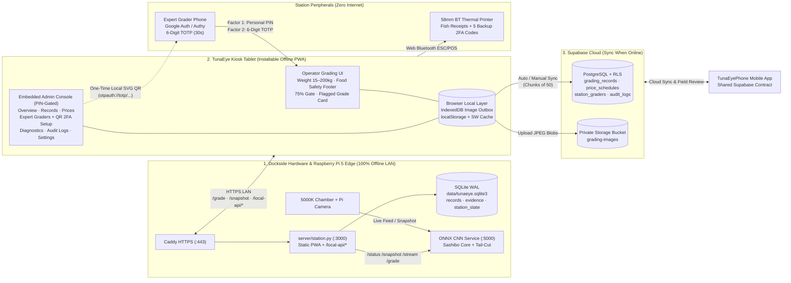
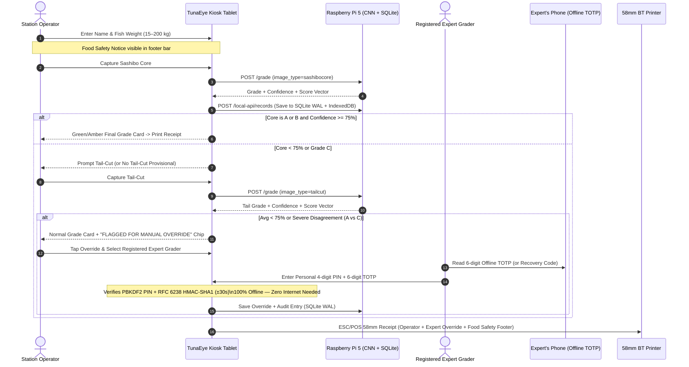

# TunaEye — Actual System Design & Data Flows

This document reflects the **real implemented TunaEye architecture** — where the **Admin Console lives inside the Kiosk Tablet**, inference + SQLite durability run **100% offline on the Raspberry Pi 5**, overrides use **per-expert PIN + 100% offline TOTP 2FA**, and **Supabase Cloud** syncs records, images, and append-only audit logs whenever internet returns.

---

## 1. End-to-End Architecture

---

## 2. Dynamic Flow — Scanning, Decision Gate & Offline TOTP 2FA Override

---

## 3. Offline Durability & Cloud Sync Lifecycle

1. **Immediate Local Write (Zero Data Loss Offline):**
   - Captured image blobs save to **IndexedDB (`tunaeye-offline`)** and mirror to **SQLite WAL (`data/tunaeye.sqlite3` `evidence` table)**.
   - Grading records, Expert Graders (salted PBKDF2 PIN hashes + TOTP secrets + hashed recovery codes), Admin PIN, Price Schedule, Settings, and Audit Logs mirror to **SQLite WAL (`records` + `station_state` tables)** via `/local-api/*`.
   - If browser cache is cleared, startup (`restoreSqliteRecords()` + `restoreSqliteStationState()`) automatically restores everything from the Pi's SQLite database.
2. **Automatic or Manual Cloud Sync (When Wi-Fi Returns):**
   - Triggered on `window` `online` event (when **Auto-sync when online** is ON in Admin Settings) or manually via **Sync now**.
   - Drains the **entire pending queue in chunks of 50**, uploads evidence blobs to private bucket `grading-images`, verifies PostgreSQL read-back field equality, and uploads unsynced entries to append-only `public.audit_logs`.
