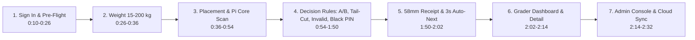

# TunaEye v2.7.0 — Animated Demo Video Flow, Storytelling & Sound Blueprint

Clean, cohesive storyboard, IF-THEN decision showcase, sound-design cue sheet, and demo use-case matrix — structured like the **TunaEye Guide** (`Sign in -> Weight -> Scan Core -> Tail-Cut (only if needed) -> Grade card -> Receipt -> Dashboard / Admin / Sync`), focused strictly on the core product story (no minor edge-case detours like duplicate-initial prompts).

---

## 1. Brand & Motion Identity

| Token | Value | Usage in Video |
| :--- | :--- | :--- |
| **App Icon** | [`public/assets/applogo.svg`](../public/assets/applogo.svg) | Intro sting, corner badge, outro lockup |
| **Primary Tagline** | **Sea Beyond the Cut.** | Hero title reveal |
| **Core Story Line** | *"We don't replace the expert eye. We extend its reach."* | Act 1 hook & Act 6 Override |
| **Sub-tagline** | *"Built on expert knowledge. Enhanced by computer vision."* | Outro |
| **Fonts** | `Open Runde`, `Inter`, italic serif (`Beyond`, `records`, `grade`, `needed`) | Kinetic callouts & screen titles |
| **Palette** | Deep Ocean `#0F172A` / `#103B70` · Cobalt `#2563EB` · Frost `#F4F7FB` | Studio backdrop & UI containers |
| **Grade Cards** | **A** `#0D9458 -> #12A56A` · **B** `#D97706 -> #EAB308` · **C** `#DC2626 -> #EF4444` · **Override** `#090D16 -> #1E293B` | Full-bleed card reveals & glows |

---

## 2. Sound Design & Music Cue Sheet

- **Music Bed**: Warm minimal marimba + deep ocean ambient pad (`98 BPM`, `C major` -> brief suspended tension on Tail-Cut / Invalid -> resolves cleanly to `C major` on Grade & Receipt).
- **Voiceover**: Calm, confident, human-first (`0.4s` gap around UI SFX).

| Time | Cue | Sound Effect (SFX) | Visual Action |
| :--- | :--- | :--- | :--- |
| `0:00` | **Ocean Intro Sting** | Underwater sub-swell + water-drop chime | `applogo.svg` -> `"Sea Beyond the Cut."` |
| `0:10` | **UI Glass Tap** | Crisp soft click (`-14 dBFS`) | Tap **Start Grading** on Welcome |
| `0:18` | **Pre-Flight Pulse** | 5 quick rising soft ticks -> green chime | Live 6-check readiness modal |
| `0:28` | **Keypad Ticks** | Ceramic tactile taps (`7`, `8`, `.`, `1`, `2`) | Weight entry (`15–200 kg`) |
| `0:36` | **Chamber Glide** | Mechanical tray slide + soft 5000K LED hum | 3-step Placement Guide (`2s` cards) |
| `0:46` | **Pi Shutter + Scan** | Camera shutter + `300ms` radar sweep | Raspberry Pi camera Sashibo Core scan |
| `0:56` | **Grade A / B Chord** | Bright major triad chime | Green **Grade A (96.3%)** & Yellow **Grade B (94%)** |
| `1:08` | **Confidence Dip** | Soft suspended chord | Core `< 75%` or **Grade C** -> **Tail cut needed** |
| `1:18` | **Tail Upgrade Lift** | Rising harmonic arpeggio | `Scan Tail-Cut` blends Core + Tail -> Final Grade |
| `1:30` | **Alert Thud** | Muted double-knock (non-harsh) | Non-tuna object -> `Cannot Be Determined` -> camera reset |
| `1:40` | **Override Seal** | Metallic PIN clicks + firm lock thump | Black **Manual override required** card + PIN `1234` |
| `1:52` | **58mm Thermal Print** | Authentic `58mm` thermal paper zip + tear | Auto-print `700ms` -> `3, 2, 1` **Grade another** |
| `2:04` | **Dashboard Flip** | Soft card-flip swoosh + tap | Grader Dashboard (`My records` / `All device records` + Record Detail) |
| `2:14` | **Admin Unlock** | 4 crisp keypad tones (`1-2-3-4`) + unlock chime | Admin PIN -> Overview, Records, Graders, Devices, Settings, Audit |
| `2:28` | **Cloud Sync Shimmer** | Upward harmonic pulse (`C5 -> G5`) | Kiosk + Mobile (`source: 'mobile'`) sync to Supabase |
| `2:34` | **Outro Resolve** | Warm ocean fade-out + single chime | `applogo.svg` + `"Sea Beyond the Cut."` |

---

## 3. Journey of One Fish (`2:20` Cohesive Video Flow)



### Act 1 — Hook & Welcome (`0:00 – 0:18`)
- **Visuals**: [`applogo.svg`](../public/assets/applogo.svg) -> [`00-landing-page.png`](../public/kiosk-screens/00-landing-page.png) (`Sea Beyond the Cut.`) -> [`01-welcome.png`](../public/kiosk-screens/01-welcome.png) (`TunaEye Station 01 · Ready`, `v2.7 · Updates`, `Start Grading`).
- **Narration**: *"TunaEye runs 100% offline on a Raspberry Pi 5. One tap starts grading — extending expert human judgment with computer vision."*

### Act 2 — Grader Sign-In & Weight (`0:18 – 0:36`)
- **Visuals**: [`02-grader-identity.png`](../public/kiosk-screens/02-grader-identity.png) (enter grader name, **Test print** BT pre-pair, Live pre-flight check) -> [`03-weight-entry.png`](../public/kiosk-screens/03-weight-entry.png) (`78.12 kg`, `15–200 kg` limit).
- **Narration**: *"The grader signs in, verifies Pi readiness, and enters the fish weight on the touch keypad."*

### Act 3 — Chamber Placement & Pi Camera Scan (`0:36 – 0:54`)
- **Visuals**: Fast 3-beat glide of [`04-placement-guide.png`](../public/kiosk-screens/04-placement-guide.png), [`04b-placement-guide-step2.png`](../public/kiosk-screens/04b-placement-guide-step2.png), [`04c-placement-guide-step3.png`](../public/kiosk-screens/04c-placement-guide-step3.png) -> [`05-core-capture.png`](../public/kiosk-screens/05-core-capture.png) / [`20-core-camera-live.png`](../public/kiosk-screens/20-core-camera-live.png) (locked to **Raspberry Pi camera**).
- **Narration**: *"Slide the sample into the 5000K lighting chamber. TunaEye captures and grades directly from the Raspberry Pi camera."*

### Act 4 — Every Decision Rule & Demo Outcome (`0:54 – 1:50`)
Clean, rhythmic showcase of the exact **IF -> THEN** decision engine:
1. **Confident Grade A / B (`75%+`)**: Skips Tail-Cut -> Green [`demo-01-grade-a.png`](../public/kiosk-screens/demo-01-grade-a.png) (`96.3%`) & Amber [`demo-02-grade-b.png`](../public/kiosk-screens/demo-02-grade-b.png) (`94%`).
2. **Low Confidence (`< 75%`) or Grade C**: Opens [`demo-03-grade-c-tailneed.png`](../public/kiosk-screens/demo-03-grade-c-tailneed.png) -> [`21-tail-needed-correct.png`](../public/kiosk-screens/21-tail-needed-correct.png) (`Scan Tail-Cut` | `No Tail-Cut`):
   - **Scan Tail-Cut**: Combines both cuts -> [`demo-05-tail-upgrades-a.png`](../public/kiosk-screens/demo-05-tail-upgrades-a.png) (Tail lifts to **A**), [`demo-04-needs-tail.png`](../public/kiosk-screens/demo-04-needs-tail.png) (Combined **B**), or [`demo-03b-grade-c-final.png`](../public/kiosk-screens/demo-03b-grade-c-final.png) (Red **Grade C**).
   - **No Tail-Cut (`60%+`)**: [`demo-07-no-tail-provisional.png`](../public/kiosk-screens/demo-07-no-tail-provisional.png) (`PROVISIONAL`).
3. **Invalid / Non-Tuna Image (`422`)**: [`05b-invalid-sample-modal.png`](../public/kiosk-screens/05b-invalid-sample-modal.png) (`Cannot Be Determined` for `2s`, clears frame, reopens camera).
4. **Black Card — Manual Override (`< 75%` combined or A vs C clash)**: [`demo-09-needs-expert.png`](../public/kiosk-screens/demo-09-needs-expert.png) -> [`27-override-dialog.png`](../public/kiosk-screens/27-override-dialog.png) (Supervisor PIN `1234` + reason chip).
- **Narration**: *"High-confidence Sashibo cores print immediately. Grade C or uncertain cores request a Tail-Cut check. Non-tuna objects are rejected, and any severe disagreement locks behind an expert PIN override."*

### Act 5 — 58mm Receipt & 3-Second Auto-Next (`1:50 – 2:02`)
- **Visuals**: [`10-receipt.png`](../public/kiosk-screens/10-receipt.png) (`POS-58 THERMAL` auto-print after `700ms` when BT paired) -> [`11-completion.png`](../public/kiosk-screens/11-completion.png) (`Grade another` `3, 2, 1` countdown back to Weight).
- **Narration**: *"One tap — or automatic Bluetooth print — issues a 58mm receipt, then resets in three seconds for the next fish."*

### Act 6 — Grader Dashboard & Record Detail (`2:02 – 2:14`)
- **Visuals**:
  - [`19-grader-dashboard.png`](../public/kiosk-screens/19-grader-dashboard.png): Shows **My records** (default per-grader view) vs. **All device records** filter, today's stats (`Sessions today`, `Samples graded`), `Sync now`, red **Logout**, sample thumbnails, and page navigation.
  - [`19b-grader-dashboard-empty.png`](../public/kiosk-screens/19b-grader-dashboard-empty.png): New grader starts clean with `No records yet`.
  - Tap any row -> [`18-record-detail.png`](../public/kiosk-screens/18-record-detail.png) / [`35-record-detail-full.png`](../public/kiosk-screens/35-record-detail-full.png): Full captured Sashibo & Tail-Cut photos (tap to zoom), grade breakdown, and **Reprint receipt**.
- **Narration**: *"Each grader sees their own history at a glance — or switches to all device records, inspects evidence photos, and reprints any receipt."*

### Act 7 — Admin Console & Cloud Sync (`2:14 – 2:32`)
- **Visuals**:
  - **PIN Entry**: [`12-admin-pin.png`](../public/kiosk-screens/12-admin-pin.png) (`1234` keypad).
  - **Overview**: [`13-admin-overview.png`](../public/kiosk-screens/13-admin-overview.png) / [`30-admin-overview.png`](../public/kiosk-screens/30-admin-overview.png) (7 time filters: `All time`, `Last month`, `Last week`, `Today`, `Yesterday`, `An hour ago`, `Older > 30d`, 7-day volume chart, grade distribution ring, and secret `A` safety-net button next to `Logout`).
  - **Records & Evidence Audit**: [`14-admin-records.png`](../public/kiosk-screens/14-admin-records.png) -> [`14b-admin-record-detail.png`](../public/kiosk-screens/14b-admin-record-detail.png) (sample photo, saved rate, original prediction vs. override, sync badge, CSV export).
  - **Expert Graders**: [`15b-admin-expert-graders.png`](../public/kiosk-screens/15b-admin-expert-graders.png) (registered graders, sample counts, **View records** jump).
  - **Devices, Settings & Audit Log**: Fast 3-beat montage of [`15-admin-devices.png`](../public/kiosk-screens/15-admin-devices.png) (Pi camera, BT printer, network checks), [`16-admin-settings.png`](../public/kiosk-screens/16-admin-settings.png) (station name, Pi URL, pricing, PIN), and [`17-admin-audit-log.png`](../public/kiosk-screens/17-admin-audit-log.png) (full chronological trail).
  - **Cloud Sync**: [`01b-welcome-sync-modal.png`](../public/kiosk-screens/01b-welcome-sync-modal.png) showing Kiosk (`source: 'kiosk'`) + Mobile (`source: 'mobile'`) converging into one Supabase ledger.
- **Narration**: *"Behind PIN-protected Admin access, supervisors filter station metrics, audit every override and photo, manage graders and pricing, run Pi diagnostics, and sync Kiosk and Mobile records to one cloud ledger."*

### Act 8 — Outro (`2:32 – 2:40`)
- **Visuals**: [`applogo.svg`](../public/assets/applogo.svg) + **"TunaEye — Sea Beyond the Cut."** + *"Built on expert knowledge. Enhanced by computer vision."*

---

## 4. Demo Presets & Screen Assets (`src/demoMode.ts`)

| Preset (`id`) | Kiosk Label | What It Showcases | Screen Asset |
| :--- | :--- | :--- | :--- |
| `confident` | `Sashibo accepts` | Grade **A** (`96.3%`) direct to receipt | [`demo-01-grade-a.png`](../public/kiosk-screens/demo-01-grade-a.png) |
| `grade-b` | `Grade B` | Grade **B** (`94.0%`) direct to receipt | [`demo-02-grade-b.png`](../public/kiosk-screens/demo-02-grade-b.png) |
| `grade-c` | `Grade C` | Core `94% C` -> Tail-Cut prompt -> Red Final **C** | [`demo-03-grade-c-tailneed.png`](../public/kiosk-screens/demo-03-grade-c-tailneed.png) / [`demo-03b-grade-c-final.png`](../public/kiosk-screens/demo-03b-grade-c-final.png) |
| `needs-tail` | `Tail cut needed` | Core `74.2% C` + Tail `91.4% B` -> Blended **B** | [`demo-04-needs-tail.png`](../public/kiosk-screens/demo-04-needs-tail.png) |
| `core-uncertain-tail-a` | `Tail upgrades to A` | Core `71.5% B` + Tail `93.8% A` -> Upgraded **A** | [`demo-05-tail-upgrades-a.png`](../public/kiosk-screens/demo-05-tail-upgrades-a.png) |
| `core-uncertain-tail-c` | `Tail confirms C` | Core `72.4% B` + Tail `89.2% C` -> Blended outcome | [`demo-06-tail-confirms-c.png`](../public/kiosk-screens/demo-06-tail-confirms-c.png) |
| `no-tail-provisional` | `No tail cut (Provisional)` | Core `72.0% B` without Tail -> **PROVISIONAL** | [`demo-07-no-tail-provisional.png`](../public/kiosk-screens/demo-07-no-tail-provisional.png) |
| `borderline-75` | `Borderline 75% pass` | `75.5% B` passes without Tail-Cut | [`demo-08-borderline-75.png`](../public/kiosk-screens/demo-08-borderline-75.png) |
| `needs-expert` | `Expert needed` | Both `< 75%` -> Black **Manual override required** | [`demo-09-needs-expert.png`](../public/kiosk-screens/demo-09-needs-expert.png) |
| `tail-uncertain-expert` | `Tail also uncertain` | Core `73.2% A` + Tail `71.8% B` -> Black card PIN | [`demo-10-tail-uncertain-expert.png`](../public/kiosk-screens/demo-10-tail-uncertain-expert.png) |
| `invalid-core` | `Invalid Sashibo core` | Non-tuna in Core -> `Cannot Be Determined` (`2s`) | [`demo-11-invalid-core.png`](../public/kiosk-screens/demo-11-invalid-core.png) |
| `invalid-tail` | `Invalid Tail cut` | Non-tuna in Tail -> `Cannot Be Determined` (`2s`) | [`demo-12-invalid-tail.png`](../public/kiosk-screens/demo-12-invalid-tail.png) |

---

## 5. Remotion Production Plan (`video/`)

**Target**: `1920×1080 @ 60 fps` MP4 (`out/tunaeye-demo-v2.7.mp4`, `~160s` = `9600 frames`) using **Remotion** (`remotion`, `@remotion/cli`, `@remotion/transitions`, `@remotion/media-utils`).

### 5.1 Folder Architecture
```text
video/
├── package.json              # remotion + @remotion/transitions + react
├── remotion.config.ts        # JPEG/PNG image format + concurrency
├── public/
│   ├── assets/applogo.svg    # Copied/linked from ../public/assets/
│   ├── kiosk-screens/*.png   # All verified screenshots from ../public/kiosk-screens/
│   └── audio/                # Synthesized WAV SFX + 98 BPM ocean marimba bed
└── src/
    ├── index.ts              # registerRoot(RemotionRoot)
    ├── Root.tsx              # <Composition id="TunaEyeDemo" width={1920} height={1080} fps={60} />
    ├── theme.ts              # Open Runde / Inter, Deep Ocean #0F172A, Cobalt #2563EB, Grade A/B/C
    ├── scenes/
    │   ├── HeroLockup.tsx    # Intro & Outro spring() logo + "Sea Beyond the Cut."
    │   ├── TabletScene.tsx   # Reusable 3D tablet bezel + Ken Burns zoom + scan-line + bullets
    │   └── DecisionMontage.tsx # Rapid A / B / C / Tail-Cut / Black PIN showcase
    └── TunaEyeDemo.tsx       # TransitionSeries orchestrating Acts 1–8 + <Audio> cues
```

### 5.2 Transitions & Motion Choreography
- **Between Acts**: `<TransitionSeries.Transition presentation={slide({ direction: 'from-right' })} timing={springTiming({ config: { damping: 200 } })} />` (`18–24 frames`).
- **Modal / Alert Reveals**: `fade()` (`12 frames`) + subtle scale `spring({ fps, frame, config: { damping: 14, stiffness: 160 } })`.
- **Tablet Bezel**: Continuous subtle `interpolate()` Ken Burns zoom (`0.96 -> 1.02`) + 3D perspective (`rotateY(-4deg -> -1deg)`).
- **Camera Scan Scene**: Animated glowing `#38BDF8` horizontal sweep line synced with `shutter.wav`.
- **Grade Reveals**: Ambient backdrop glow shifts dynamically (`#12A56A` Grade A, `#EAB308` Grade B, `#EF4444` Grade C).

### 5.3 Audio & Render Pipeline
1. Generate clean offline `.wav` SFX stems (`intro.wav`, `tap.wav`, `keypad.wav`, `glide.wav`, `shutter.wav`, `gradeA.wav`, `gradeB.wav`, `tail.wav`, `lift.wav`, `alert.wav`, `lock.wav`, `print.wav`, `sync.wav`) + `ocean-bed-98bpm.wav` into `video/public/audio/`.
2. Mount `<Audio src={staticFile('audio/ocean-bed-98bpm.wav')} volume={0.22} loop />` + per-scene `<Sequence from={...}><Audio src={staticFile('audio/...')} /></Sequence>`.
3. Preview interactively in Remotion Studio (`npx remotion studio`) and render final MP4:
   ```powershell
   cd video
   npx remotion render TunaEyeDemo out/tunaeye-demo-v2.7.mp4
   ```
