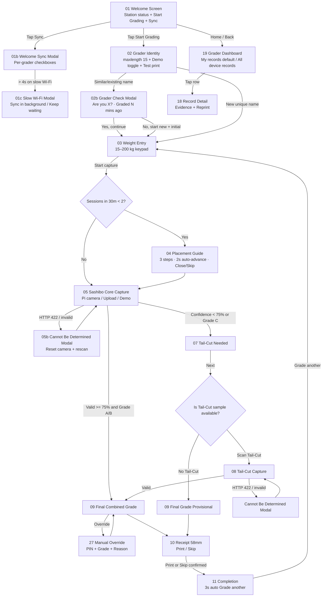

# TunaEye Mobile App — Base Template & Flow Specification

Portable specification for **TunaEye Mobile** (`TunaEyePhoneLEGIT`) to mirror the **TunaEye Kiosk** grading workflow, screens, local offline queue, and **Supabase** cloud sync — **without Admin** (`pin`, `admin` console, price editing, hardware diagnostics, or audit logs).

All records synced from mobile write to the **same Supabase project** (`source: 'mobile'`) defined in [`docs/SHARED_SUPABASE_CONTRACT.md`](./SHARED_SUPABASE_CONTRACT.md) so the Kiosk Admin Console and Cloud Dashboard see them immediately.

---

## 1. Decision & Screen Flow

---

## 2. Included vs. Excluded Surfaces

| Surface | Mobile App | Notes |
| :--- | :--- | :--- |
| Welcome + Per-Grader Sync + Slow Wi-Fi Modal | **Included** | Syncs pending local records to shared Supabase |
| Grader Identity + Phonetic/Duplicate Check | **Included** | `maxlength=15`, `Are you X?`, last-initial disambiguation (`Cat H.`, `Kat Ho.`) |
| Weight Entry (`15–200 kg`) | **Included** | Numeric keypad + `Order TE_XXXX` + `Grader` badge |
| Placement Guide (3 steps) | **Included** | `2s` auto-advance, `Close` / `Skip` button, skipped after 2 sessions in 30m |
| Sashibo Core & Tail-Cut Capture + Inference | **Included** | Same thresholds (`>= 75%`, Grade `C` triggers Tail-Cut check), `Cannot Be Determined` modal on invalid |
| Final Grade, Manual Override, Receipt, Completion | **Included** | `3s` auto-countdown to `Grade another` |
| Grader Dashboard (`My records` / `All device records`) & Record Detail | **Included** | Shows `No records yet` for new grader; `All device records` shows grader name per row |
| Admin Console (`PIN`, `Overview`, `Records`, `Prices`, `Graders`, `Devices`, `Audit`) | **Excluded** | Admin stays on Kiosk / Web Admin; mobile reads `price_schedules` from Supabase/cache |

---

## 3. Screen-by-Screen & Function Contract

### 3.1 Welcome & Selective Sync
- **`renderWelcome()`**
  - Displays station name (`TunaEye Station 01 · Ready`), **Start Grading** CTA, **Sync (N)** button (with pending count), and 4-step workflow bar.
- **`openWelcomeSyncModal()`**
  - Groups local records by `grader` (`pending` count + `total` count).
  - Pre-selects graders or lets operator toggle individual checkboxes / **Toggle all**.
  - **Offline behavior**: saves selected grader names to `tunaeye-pending-sync-graders` and runs `syncPendingRecords({ limit: 200, graders })` automatically on the browser/app `online` event.
  - **Slow Wi-Fi guard**: if `syncPendingRecords()` takes `> 4000ms`, opens **Slow Wi-Fi connection** modal with live `Syncing X/Y…` progress, **Sync in background**, and **Keep waiting**.

### 3.2 Grader Identity & Disambiguation
- **`validateGraderName(name: string): string`**
  - Trims whitespace, enforces `1–15` characters (`maxlength="15"`).
- **`findGraderMatches(typed: string)`**
  - Scans local records + known `station_graders` list using:
    1. Exact case-insensitive match
    2. Phonetic key (`ph->f`, `th->t`, `c/q->k`, `z->s`, collapsed double letters: `Kat` ↔ `Cat` ↔ `Kath`)
    3. Prefix match (`>= 3` chars) or Levenshtein edit distance `<= 2`
  - Returns matches sorted by most recent activity with relative time (`just now`, `5 mins ago`, `2 hours ago`).
- **`confirmGraderIdentity(typed: string): Promise<string | null>`**
  - Prompts **`Are you <Name>?`** / **`Are you the same <Name>?`** + **`Have you graded <ago>?`**.
  - **Yes, continue**: switches to existing grader profile and loads their records.
  - **No, start new**: reveals compact inline **last-initial keypad** (`1–4` chars: `A–Z`, `2–4`, `⌫`, `inputmode="none"` to avoid OS keyboard overlap) -> creates `<Base> <Initial>.` (e.g., `Cat H.`, `Kat Ho.`), checking against existing names to block duplicates (`"<Name>" already exists — add 1 more letter or number`).

### 3.3 Weight Entry
- **`setWeight(value: string)`**
  - Keypad `0–9`, `.`, `Backspace`, `Clear`.
  - Valid range: `15 <= weightKg <= 200` (1 decimal place allowed). Disables **Start capture** outside range.

### 3.4 Placement Guide
- **`showPlacementTutorial(step: 1 | 2 | 3)`**
  - Auto-advances every `2000ms` across 3 steps (`Pull out the tray`, `Place the sample`, `Close and scan`), or user taps **Next** / **Close** (to the right of **Next**).
  - Track session timestamps per grader in local storage; skip automatically once grader has `>= 2` completed sessions within the last `30 minutes`.

### 3.5 Capture, Inference & Decision Logic
- **`captureAndGrade(sampleType: 'Sashibo core' | 'Tail cut', file?: Blob)`**
  - Captures JPEG/PNG/WebP (Pi `/snapshot` or device/upload depending on mobile hardware config) and saves temporary local evidence before upload.
  - Calls `POST /grade` (or local/demo simulator when Demo Mode is explicitly enabled).
  - **Invalid / HTTP 422**: deletes temporary evidence, resets camera preview, and shows **`Cannot Be Determined`** modal (`This image is not recognized as a valid <sample>. Camera reset — please scan again.`).
  - **Decision thresholds (`ACCEPT_CONFIDENCE = 75`)**:
    - If `sampleType === 'Sashibo core'` AND (`confidence < 75` OR `grade === 'C'`): navigate to **Tail-Cut Needed** (`tailneed`).
    - Otherwise: navigate to **Final Grade** (`final`).
- **`tailCutAvailabilityModal()`**
  - **`Scan Tail-Cut`**: routes to Tail-Cut capture (`tail`), then blends Core + Tail-Cut scores into Final Combined Grade.
  - **`No Tail-Cut`**: marks `provisional = true` and routes to Final Grade with Sashibo Core result.

### 3.6 Final Grade, Override, Receipt & Completion
- **`applyOverride(pin: string, grade: 'A' | 'B' | 'C', reason: string)`**
  - Validates supervisor PIN, requires non-empty `reason`, stores `override_grade`, `override_reason`, `override_actor`, `override_at`, while **preserving** `original_grade` and `raw_confidence`.
- **`printOrSkipReceipt()`**
  - Renders 58mm thermal layout (`order`, `station`, `grader`, `weight_kg`, `grade`, `unit_rate_per_kg`, `total_fish_price`, `core`/`tail` breakdown).
  - Tapping **Skip** requires confirmation modal (`Skip printing?` -> `The record remains saved locally.`).
- **`onSessionComplete()`**
  - Saves local record with `syncState: 'pending'` + JPEG evidence in IndexedDB/SQLite.
  - Shows completion screen with `3s` auto-countdown to **Grade another** (keeps current `graderName`, resets weight/images for next fish).

### 3.7 Grader Dashboard & Record Detail
- **`getDashboardHistory(graderName: string, scope: 'mine' | 'all')`**
  - **`mine` (default)**: filters strictly to `record.grader === graderName`. **Never falls back to other graders' records.** If empty, displays **`No records yet`** and `0` stats.
  - **`all` (`All device records` pill)**: shows all local records on the device and renders the grader name (`· Kat`) on each row.
  - Paginates (`Prev` / `Next`) cleanly when records exceed 1 page.
- **`openRecordDetail(recordId: string)`**
  - Displays captured photo, sample type, weight, grade, original confidence, total value, sync badge (`Synced` / `Saved locally` / `Retry needed`), and **Reprint receipt**.

---

## 4. Pi & Cloud Sync Contract (`source: 'mobile'`)

### 4.1 Pi Endpoints
| Endpoint | Method | Purpose |
| :--- | :--- | :--- |
| `/status` | `GET` | Health + loaded models (`sashibocore`, `tailcut`) |
| `/snapshot` | `GET` | Single JPEG frame from chamber camera |
| `/stream` | `GET` | MJPEG live preview stream |
| `/grade` | `POST` | Multipart `image` + `sample_type` (`sashibocore` \| `tailcut`); returns `grade`, `confidence`, `raw_confidence`, `scores`, `capture_id`, `inference_id` (or `422` if invalid) |

### 4.2 Supabase Sync Rules
- **Project**: Same `VITE_SUPABASE_URL` + `VITE_SUPABASE_ANON_KEY` as Kiosk (`docs/SHARED_SUPABASE_CONTRACT.md`).
- **Session**: `ensureSupabaseUser()` (anonymous auth or signed-in grader session).
- **Storage**: Upload JPEG to private bucket `grading-images` at `{user_id}/{record_id}/{sample_type}.jpg` with `{ upsert: true }`.
- **Database**: Upsert into `public.grading_records` on `id` with **`source: 'mobile'`**, **`station_id`**, **`grader_name`**, **`weight_kg`**, **`grade`**, **`confidence`**, **`raw_confidence`**, **`scores`**, **`grade_unit_rate_per_kg`**, **`total_fish_price`**, **`image_path`**, **`captured_at`**, **`updated_at`**.
- **Verification**: Use `.upsert(row, { onConflict: 'id' }).select(...).single()`. Compare numeric fields (`raw_confidence`, `confidence`, `weight_kg`, `scores` values) with **`<= 1e-3` float tolerance** so PostgreSQL `real`/`numeric` rounding never triggers false `Retry needed` failures.
- **Pricing**: Read active station rates (`A`, `B`, `C`) from `price_schedules` (filtered by `station_id`) when online and cache locally; fall back to cached rates when offline.
- **Graders**: Upsert active grader names to `station_graders` (`id = "{user_id}:{station_id}:{grader_lower}"`) when online so Kiosk & Mobile share known grader names.

---

## 5. Minimal Port Checklist for Mobile Repo
1. Copy/adapt state types (`SessionState`, `GradingRecord`, `SyncState`) and `decisionFor()` threshold logic (`75%`, Grade `C` -> Tail-Cut).
2. Copy/adapt `cloudSync.ts` with **`source: 'mobile'`** and `<= 1e-3` numeric verification tolerance.
3. Implement the 11 grader screens + 4 modals (`Welcome Sync`, `Slow Wi-Fi`, `Grader Check`, `Cannot Be Determined`, `Tail-Cut Available`, `Override`, `Skip Receipt`) without Admin routes.
4. Test offline capture -> reconnect -> Welcome Sync -> verify row appears in Kiosk Admin Console (`Records`) and Supabase `grading_records` with `source = 'mobile'`.
